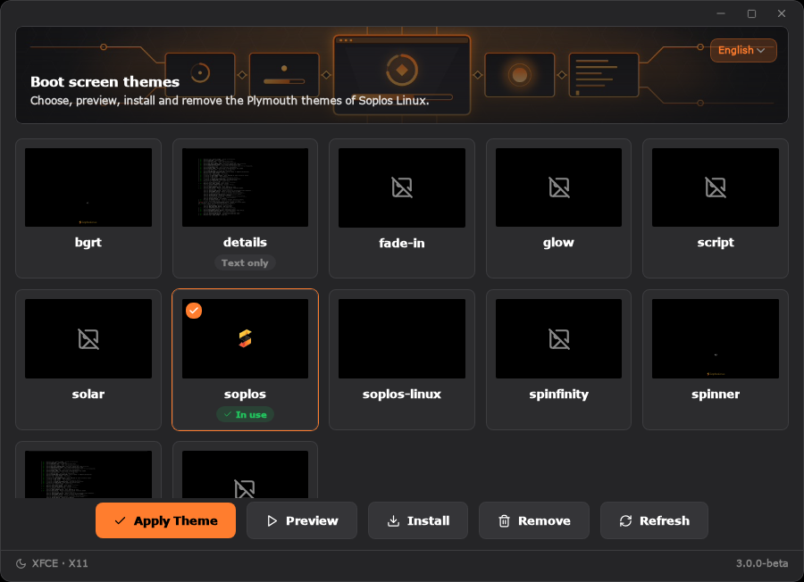
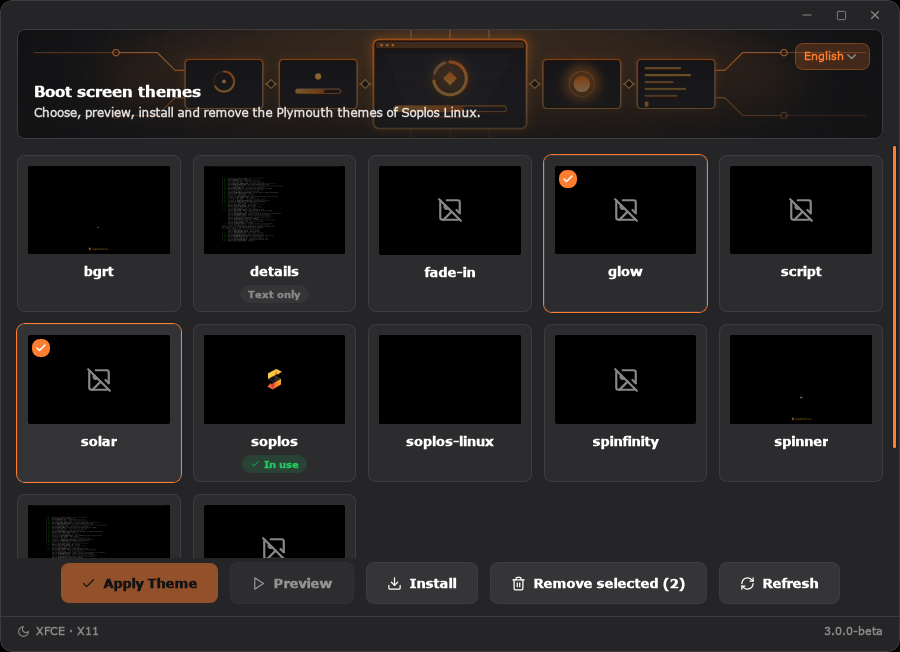

# Soplos Plymouth Manager 3.0


Plymouth boot splash theme manager for Soplos Linux.

Choose which theme the boot screen shows, preview it, install new ones from an archive and remove the ones you no longer want, on Xfce, Plasma and GNOME, with X11 or Wayland.

|  The gallery of boot screen themes, with the one in use marked |  Removing several selected themes at once |
|:---:|:---:|
|  A theme shown by the preview before applying it | |

## Status

This is the first beta of the rewrite, after the alpha was tested on real hardware. Every action does its work: applying sets the default theme and rebuilds the initramfs, previewing shows the theme for real and takes a picture of it, installing unpacks an archive into the themes folder and removing deletes the themes. Report anything that fails.

## Architecture

Version 3.0 is a ground-up rewrite of Soplos Plymouth Manager. The original app was written in Python 3 with GTK3 (PyGObject). This rewrite replaces that stack with Tauri 2: a Rust backend and a Svelte 4 + Tailwind CSS frontend, rendered through the system's WebKitGTK.

- **Backend** (`src-tauri/`): the commands that read the system (`src/commands/themes.rs` and `environment.rs`), the jobs that make the changes (`actions.rs`, `jobs.rs`), the privileged helper (`privileged.rs`) and the preview (`preview.rs`).
- **Frontend** (`src/`): one window, as in the 2.x program, with the frame of the other Soplos 3.0 programs that have no sidebar (a hero with the language, a thin footer with the theme button, the session and the version), the gallery of themes with the buttons under it, shared dialogs, the progress bar along the bottom edge while a job runs, and the 8-language dictionaries under `src/i18n/`. There is no log: a job that fails says why in a dialog.
- **Privileges**: the window itself never runs as the superuser. The changes run in the same executable started through `pkexec` with a closed list of operations (apply, install, remove, preview), written to a private file, validated in the window and again as the superuser. One password is asked for each action. The Polkit action is declared in `resources/polkit/org.soplos.plymouthmanager.policy`.
- **Preview**: a graphical theme is shown by Plymouth in a nested X server (Xephyr), and a picture is taken a few seconds after the splash is up; the helper saves it as the `preview.png` of the theme folder, as the 2.x program did, and it is shown on the card from then on and goes away with the theme. The themes that draw on the text console (tribar, bgrt) are shown in a full-screen terminal instead. It works from an X11 or a Wayland session (through XWayland). The theme in use before the preview is put back when it ends.

## Installation

```bash
sudo apt install soplos-plymouth-manager
```

## Features

- **Themes**: a gallery of the installed themes with their image and name, the one in use marked. The description of a theme shows when the pointer rests on its card.
- **Actions**: apply, preview, install from an archive (`.zip`, `.tar.gz`, `.tar.xz`, `.tar.bz2`), remove and refresh. The theme in use cannot be removed, and text-only themes cannot be previewed.
- **Several at once**: Ctrl or Shift click, or the box in the corner of a card, select several themes, and Remove takes all of them away after one question. The theme in use is left out.
- **dracut and initramfs-tools**: Soplos uses dracut and Debian uses initramfs-tools. Both are supported, and the initramfs of every kernel is rebuilt with `update-initramfs -u -k all`: on Soplos it is dracut's own wrapper, which also copies the new initramfs to the EFI partition when the system boots with systemd-boot. `dracut` alone is used only when the wrapper is missing. mkinitcpio is detected too.
- **X11 and Wayland**: the session is detected and shown, with the desktop, in the footer.
- **Progress**: a bar along the bottom edge of the window while a job runs. If something fails, a dialog says what.
- **Light and dark**: the window follows the theme of the desktop, with a button in the footer to choose.

## Dependencies

- `pkexec` (Polkit), for the changes to the system.
- `plymouth` and `plymouth-x11`, and `dracut` or `initramfs-tools`.
- For the preview: `xserver-xephyr`, `xterm`, `xdotool`, `x11-xserver-utils` and `scrot` or `imagemagick`.
- `tar` and `unzip`, to unpack theme archives.

All of them are installed with the package.

## Keyboard shortcuts

| Shortcut | Action |
|---|---|
| F1 | Open About dialog |
| Ctrl+Q | Quit application |
| F5, Ctrl+R | Refresh the list of themes |
| Ctrl+A | Apply the selected theme |
| Ctrl+P | Preview the selected theme |
| Ctrl+I | Install a theme |
| Delete | Remove the selected theme |

## Documentation

A Unix manual page is included and installed with the package:

```bash
man soplos-plymouth-manager
```

## Languages

The interface is available in 8 languages: English, Español, Deutsch, Français, Italiano, Português, Română and Русский. It starts in the system language and falls back to English.

## Building

```bash
npm install
npm run tauri dev      # development
./package.sh           # builds the .deb and moves it to ~/Descargas/SoplosApps
```

## License

Copyright © 2026 Sergi Perich <info@soploslinux.com>. Published under the GPL-3.0-or-later license. See `LICENSE`.
